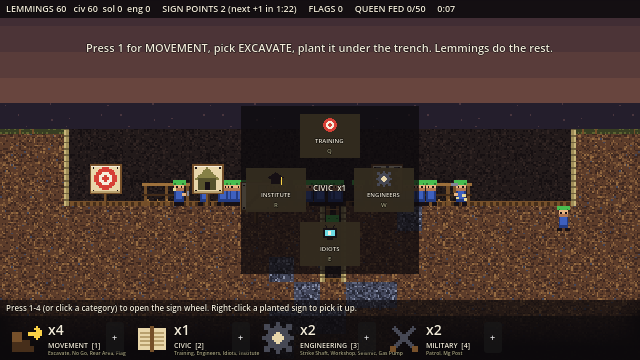
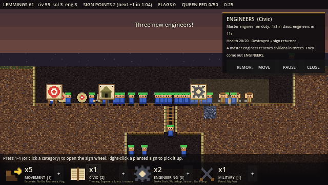
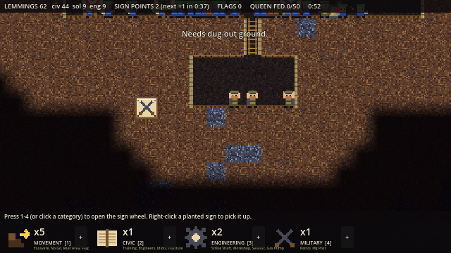
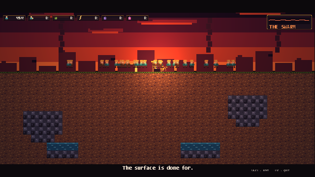
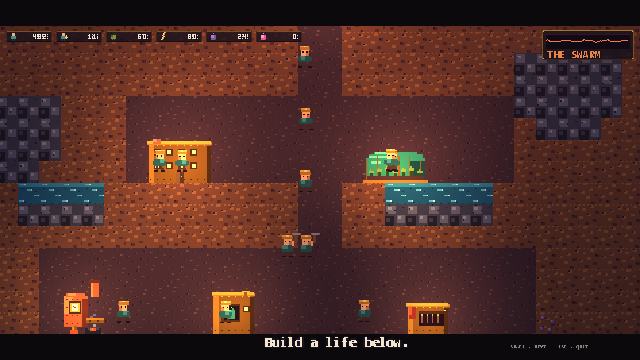
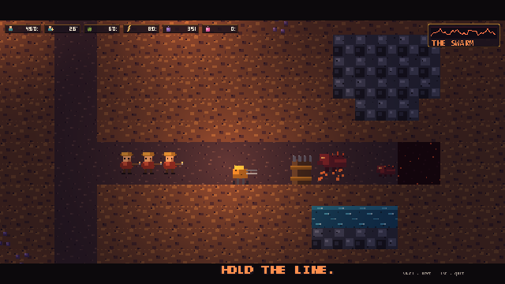
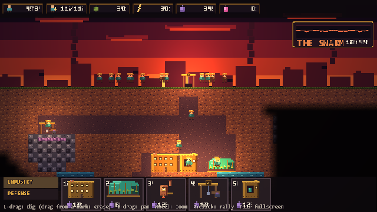

# LEMMINGS APOCALYPSE — the sign-economy pivot (2026-10-26)

*A re-imagining of Lemming Wars, built as a playable Godot mock-up to talk about. Alon's design, Emily's build.*

**You never command a lemming. You plant SIGNS.** A sign says "this patch of ground is now a thing." Civilians wander over and build it, one of them crowns himself the boss, and it runs on groups of three until you pull the sign or the bugs wreck it. Wrecked gives you the sign back. Signs are rationed. Signs are the whole economy.

- **Soldiers fight sideways** (patrol strips, MG posts). **Engineers fight down** (strike shafts: bore a hole, drop six firebombs, sign comes back). **Civilians scream.**
- **Schools have a cap:** nine soldiers, then a sergeant, then full. Every extra training zone needs a free sergeant to run it.
- **Bugs kidnap.** Raiders tunnel up for the easy meat and carry it to the queen. Fifty eaten and she rises. Kill her first and you win.
- **Flags** are your supply line (Iwo Jima pose, more lemmings, another movement sign). **Gas** deepens with depth: bugs love it, lemmings hate it, the hive only spreads where it is. New nests sprout inside the gas zone, so it climbs toward you.
- WWI trenches vs organic hive tunnels.

### Run it
1. Godot 4.6.x (4.6.1 is what it was built with).
2. Open this folder as a project, run `scenes/Signs.tscn` (or run the project and press the LEMMINGS APOCALYPSE button on the old menu).
3. Press **1-4** (or click a category at the bottom) to open the sign wheel, pick a sign, plant it. Start with MOVEMENT → EXCAVATE under the trench. Left-click a planted sign for its card (Remove / Move / Pause). Right-click a sign to pick it up. WASD or right-drag pans, wheel zooms, P pauses.

### Where things are
- `scripts/signs.gd` — the whole mode, self-contained. Every number lives in the `BAL` block at the top; the sign catalog is the `SIGNS` dict; categories are `CATS`.
- `tools/gen_signs.py` — draws every sprite with PIL into `assets/signs/`. Edit, rerun, done.
- Headless checks: `godot --headless --path . res://scenes/Signs.tscn -- --autotest` (also `--autotest --mega`, `--autotest --shaft`), `--shots` for a scripted play + screenshots.

### Honest state
Mock-up, one afternoon old. Lemmings clamber through open air inside rooms (no gravity, no real ladders). Balance is untouched by a human beyond one session. It exists to make the idea arguable, not to ship.

---

# EVERYONE DOWN!

*A small game from Upstairs — prototype + pitch, built 2026-08-31.*

The apocalypse is topside and **500 survivors are dying on a clock**. Dig down Lemmings-style, build a steampunk colony underground, mine the bedrock seams — but every sound you make pulls the hive up toward you through the dark. Their tunnels meet yours: **BRWAAA.** They're a finite population too; every trog you kill early is one missing from the Big Swarm at 20:00. Survive it and you win.

*(They Are Billions' one-sitting tension x Lemmings indirect control x Dome Keeper's dig-and-defend — with a colony and a countdown nobody else has.)*

## What's in the box
- **`PLAY THE PROTOTYPE`** — the real game loop: paint-to-dig with pathfinding, fog of war, mines on ore-bearing bedrock, farms on lakes, geothermal power, tech lab (better picks / steam rifles / rock drills), armory→soldiers, turrets, barricades, rally flags, sealed cave pockets (loot or ambush), noise-driven hive AI, finite enemy population, 20-minute swarm clock, win/lose.
- **`WATCH THE PITCH`** — a 2-minute scripted cinematic of the full fantasy.

## Run it
1. Install [Godot 4.6](https://godotengine.org/download) (no other dependencies).
2. Open the project folder in Godot and press Play — or run `godot --path <this folder>`.

## Controls
| | |
|---|---|
| Left-drag | mark digging (drag from a mark = erase) |
| Right-drag / wheel | pan / zoom |
| 1–5 + click | pick & place building (Tab switches Industry/Defense) |
| Click a building | building card (staff, on/off, demolish, research) |
| R + click | rally flag (two = split forces) |
| F11 / Esc | fullscreen / menu |

## For designers
Every balance number lives in one `BAL` dictionary at the top of `scripts/game.gd`. All art and SFX are generated by the Python scripts in `tools/` — edit and rerun to reskin anything. `-- --autotest` plays the game by script and screenshots it.

*Design: Alon (from a seed by Andy). Build: Emily. One day, zero asset store.*

## LEMMINGS APOCALYPSE — the sign-economy pivot (2026-10-26)
Second game mode in this project: `scenes/Signs.tscn` + `scripts/signs.gd` (self-contained, ~1500 lines).
Launcher: Desktop `Play Lemmings Apocalypse.bat`. Also a button on the main menu.
Design: `Desktop\Emily's Workshop\Dig Game\RAMBLE_02_PIVOT_2026-10-26.md`.
- You never command a lemming. You plant SIGNS (zones). Civilians build, one self-promotes to operator, groups of 3 convert.
- Catalog + footprints + crew in `SIGNS` dict; every number in `BAL` at the top of the script.
- Art: `tools/gen_signs.py` → `assets/signs/` (edit + rerun).
- Tests (headless): `--autotest` (dig→train→patrol→fight loop), `--autotest --shaft`, `--autotest --mega` (queen rises). `--shots` = scripted play + screenshots to user://shots.
